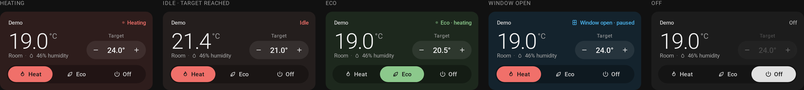

# Ambient Thermostat Card

A calm, minimal thermostat card for [Home Assistant](https://www.home-assistant.io/), made for
[Better Thermostat](https://better-thermostat.org).

The whole card tints itself to what your heating is doing: warm while heating, green in eco,
blue when an open window has paused it, and neutral when off.



- **Heat / Eco / Off** in one tap. Eco is Better Thermostat's `eco` preset.
- **Window and door awareness**: shows when Better Thermostat pauses heating because a window or door is open.
- **Target stepper** that follows the entity's own step size and min/max, and batches quick taps into one update.
- **Room temperature and humidity** at a glance.
- **Works with any `climate` entity**, but is designed around Better Thermostat.
- Visual editor, sections-view ready, English and German, about 11 KB gzipped, no dependencies besides [Lit](https://lit.dev).

## Installation

### HACS (recommended)

[](https://my.home-assistant.io/redirect/hacs_repository/?owner=andresattler&repository=ambient-thermostat-card&category=plugin)

Or manually: **HACS → ⋮ → Custom repositories**, add
`https://github.com/andresattler/ambient-thermostat-card` with type **Dashboard**, then install
**Ambient Thermostat Card for Better Thermostat**.

### Manual

1. Download [`dist/ambient-thermostat-card.js`](https://github.com/andresattler/ambient-thermostat-card/raw/main/dist/ambient-thermostat-card.js) (the latest release build).
2. Copy it to `<config>/www/ambient-thermostat-card.js`.
3. Under **Settings → Dashboards → ⋮ → Resources**, add `/local/ambient-thermostat-card.js` as a **JavaScript module**.

## Usage

Add the card from the card picker (search for "Ambient"), or in YAML:

```yaml
type: custom:ambient-thermostat-card
entity: climate.living_room
```

| Option   | Type   | Default                  | Description                       |
| -------- | ------ | ------------------------ | --------------------------------- |
| `entity` | string | **required**             | A `climate` entity.               |
| `name`   | string | entity's friendly name   | Title shown in the top-left.      |

Tap the name to open Home Assistant's more-info dialog for the thermostat.

## How it maps to Better Thermostat

| Card                       | Entity                                                                      |
| -------------------------- | --------------------------------------------------------------------------- |
| **Heat** button            | `hvac_mode: heat` (or `heat_cool` with a cooler) and `preset_mode: none`    |
| **Eco** button             | `preset_mode: eco`, turning the thermostat on first if needed               |
| **Off** button             | `hvac_mode: off`                                                            |
| Heating / Idle             | `hvac_action`                                                               |
| Window / Door open · paused | `window_open` / `door_open` attributes                                     |
| Other presets (Boost, …)   | Shown in the status, e.g. "Boost · heating"; Heat stays selected            |
| Target                     | `temperature`, stepped by `target_temp_step` within `min_temp`–`max_temp`   |
| Target while Eco (or another preset) is active | That preset's temperature, via Better Thermostat's preset `number` entity |

The **Eco** button only appears if the `eco` preset is enabled in your Better Thermostat
configuration. Humidity is hidden when no humidity sensor is configured.

Changing the target while a preset such as Eco is active adjusts **that preset's temperature**
(the same as editing Better Thermostat's "Eco temperature" entity), so the card stays in Eco.
Without that entity (e.g. other climate integrations), the card sets the plain target temperature.

With a cooler configured (range mode), the card controls the heating setpoint (`target_temp_low`).

## Theming

The state colours and backgrounds are CSS variables you can set in your theme:

```yaml
my-theme:
  ambient-heat-color: "#f0706a"
  ambient-eco-color: "#8cc98c"
  ambient-window-color: "#4cb4ee"
  ambient-off-color: "#a8a8a8"
  ambient-text-color: "#e1e1e1"
  ambient-heat-background: "#2e1d1c"       # heating
  ambient-heat-idle-background: "#241e1d"  # heat mode, idle
  ambient-eco-background: "#1d281d"
  ambient-eco-idle-background: "#1e221e"
  ambient-window-background: "#14232d"
  ambient-off-background: "#1c1c1c"
```

## Development

Requires [Bun](https://bun.sh).

```sh
bun install
bun run dev        # preview page with all states + a simulated Better Thermostat (add ?lang=de)
bun test           # unit tests for the state/service mapping
bun run build      # → build/ambient-thermostat-card.js
bun run check      # typecheck + tests + build (what CI runs)
```

To try it in a real Home Assistant, copy `build/ambient-thermostat-card.js` to `<config>/www/`
and add it as a resource (see [Manual installation](#manual)).

### Project layout

```
src/
  ambient-thermostat-card.ts  # the Lit element + card registration
  model.ts                    # entity → view state, and UI actions → service calls (pure, tested)
  localize.ts                 # translations
  styles.ts                   # all styling and theme variables
  icons.ts
dev/                          # mock-hass preview page
test/                         # bun tests
```

Adding a language: copy the `de` table in `src/localize.ts`, translate it, and register it in `languages`.

### Releasing

Run **Actions → Release → Run workflow** with a version like `0.2.0`. It runs the checks, commits
the version bump and the built `dist/ambient-thermostat-card.js`, tags `v0.2.0`, and publishes the
GitHub release. `dist/` is only ever written by this workflow; don't commit it by hand.

The build is committed rather than attached to the release because HACS (≤ 2.0.5) currently
fails to download release assets ([hacs/integration#5643](https://github.com/hacs/integration/issues/5643)).

## Credits

Inspired by [better-thermostat-ui-card](https://github.com/KartoffelToby/better-thermostat-ui-card)
and built for [Better Thermostat](https://github.com/KartoffelToby/better_thermostat), both by
KartoffelToby. This is an independent implementation and shares no code with them.

## License

[MIT](LICENSE)
